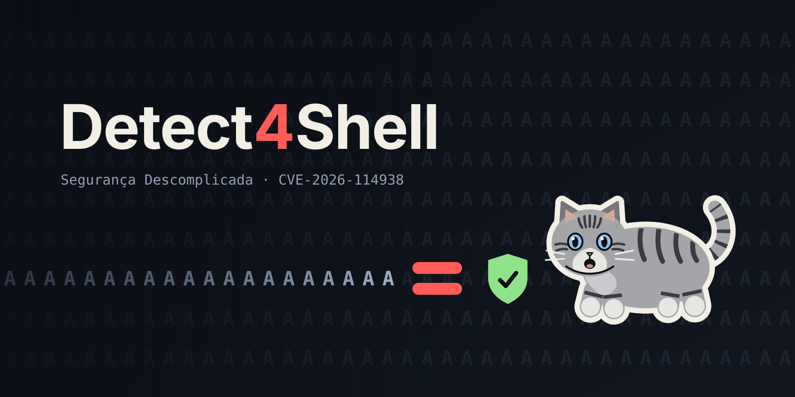
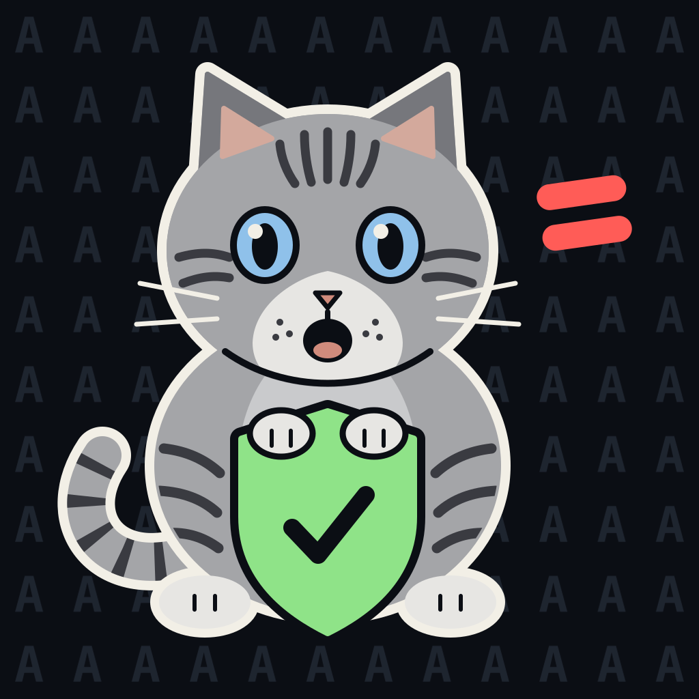

<p align="center">
  
</p>

#  Detect4Shell

**Detecção e avaliação de exposição ao Java4Shell (CVE-2026-114938) — _Segurança Descomplicada_.**
Ferramenta **defensiva** para a comunidade: ajuda times a **identificar** se estão expostos, **detectar**
tentativas e **prevenir** na borda — com instruções simples, passo a passo.

   

> **🐣 Nunca ouviu falar? Comece aqui:** [**docs/EXPLICACAO-SIMPLES.md**](docs/EXPLICACAO-SIMPLES.md) —
> o ataque explicado como para alguém de 10 anos (o que é, como funciona, implicações, e onde achar na
> sua organização). 5 minutos.

> **Aviso de escopo.** Projeto **só defensivo**. Sem exploit, sem cadeia weaponizada
> (writer/reader/JavaBleed/RCE), sem ferramenta que dispare o gatilho de corrupção de memória contra um
> alvo remoto. O único ponto em que o gatilho roda é uma **reprodução local, confinada e offline**
> (`java.util.Base64` dentro de um array do próprio programa), só para validar a detecção e verificar
> patch. Use apenas em sistemas que você está autorizado a testar.

Baseado na divulgação pública e creditando **[ikow/java4shell-poc](https://github.com/ikow/java4shell-poc)**
(MIT) + o writeup da Calif.io. Mecanismo fundamentado no commit de correção OpenJDK `5177a70b385c`
(JDK-8393212).

---

## O que é o Java4Shell (em um parágrafo)

Uma string Base64 malformada terminada em `=` (ex.: **64 chars Base64 + `=`**, ou **128 + `=`** no JDK 17)
provoca um *underflow* de inteiro no intrínseco de decodificação Base64 **AVX-512 VBMI** do HotSpot:
`output_size` vira `-1`, o `bzhiq` com índice 255 não zera bits → máscara toda-em-uns → `evmovdqub`
escreve **62 bytes além de um buffer de 50**; a `IllegalArgumentException` é lançada *depois* da escrita.
Pré-condições: OpenJDK **17.0.6+ / 21 / 25 / 27** (antes da correção `.1`), CPU **x86-64 com AVX-512 VBMI**
(Intel Ice Lake+ / AMD Zen 4+; **ARM é imune**), o intrínseco compilado pelo JIT, e o **decodificador
Basic ou URL** (MIME não é afetado).

## O que as fontes realmente mostram (honestidade sobre impacto)

Cruzamos **11 fontes públicas** (OpenJDK/Oracle, CISA, Calif.io, Amazon ALAS, Blackpoint, Chainguard,
Talos, VulnCheck, Wiz, Aikido, The Hacker News) — que em geral **ecoam o advisory original**, não são 11
confirmações independentes. Consenso:

- ✅ **Reproduzido por nós (lab confinado):** escrita **OOB de 62 bytes** (`changed=62 first=50 last=111`),
  consistente com o sintoma do descobridor. **Reportado pelas fontes** (não demonstrado por nós em
  produção): **crash (DoS)** + **leak local de heap ("JavaBleed")**.
- ⚠️ **Alegado, não reproduzido publicamente:** **RCE**. O próprio descobridor publica que o padrão do
  overflow é **fixo** (não controlado) e que o caminho ingênuo de exploração **falha**; os labs
  independentes só chegaram a **crash + leak**. A cadeia funcional é **retida**. Amazon e OpenJDK pontuam
  como difícil (CVSS 8.1, AC:H).
- 🚫 **Sem exploração in-the-wild; não está na CISA KEV** (em 2026-11-18).

**Resumo honesto:** hoje o risco real é **tirar o sistema do ar** (e talvez **vazar dado**). "Hacker
assume tudo" é possibilidade teórica, não realidade demonstrada. **Corrija assim mesmo** — derrubar um
sistema crítico já é grave.

## Validação em laboratório (o que realmente foi executado)

Reproduzido com **segurança** em container isolado `--network none` (`eclipse-temurin:21-jdk-noble` =
OpenJDK **21.0.13**, sem patch em 2026-11-18) num host AVX-512 VBMI, usando só o gatilho confinado
`laboratorio/Base64Trigger.java` (toda escrita fica dentro de um array de 4096 bytes do próprio programa):

| Execução | Resultado |
|---|---|
| build vulnerável + VBMI | **REPRODUZIDO** — `rejected=true changed=62 first=50 last=111` (bate com o descobridor, byte-por-byte) |
| `-XX:-UseBASE64Intrinsics` | **NÃO REPRODUZIDO** (`changed=0`) — mitigação confirmada |
| `-XX:UseAVX=2` | **NÃO REPRODUZIDO** (`changed=0`) — mitigação confirmada |

Também mapeamos **quais comprimentos disparam** (ground truth, nessa build): **só `A×64 + "="`** —
`A×68 / 72 / 128 / 192 / 256 + "="` **NÃO disparam**. O gatilho é um **comprimento específico por build**
(64 no JDK 21/25/27; **128 é o do JDK 17**), **não** "qualquer múltiplo de 4 ≥64" — essa precisão foi
pedida por revisores cross-vendor e confirmada em lab. `A×64+"=="` (dois pads) e sem-`=` também não
disparam. A regra usa `{16,}` **de propósito** — pega **64 e 128** (os dois gatilhos documentados) e é
robusta a variações de build; aceita **super-casar** comprimentos malformados que não disparam (ok para
detecção). Outras builds/APIs não foram testadas.

## A detecção generalizada (e a prova)

As regras upstream são **centradas em Basic auth, em parte por string exata (`AAAA…A=`), só com o
alfabeto padrão e sem cobertura de SAML** — trivialmente evadíveis. A detecção do Detect4Shell casa a
**forma estrutural** do gatilho, nos sinks pré-auth onde Keycloak/PingFederate/Jira/Confluence decodificam
Base64 (Basic/Bearer/SAML/cookie/param), **nos dois alfabetos**:

```
(?<![A-Za-z0-9+/_-])(?:[A-Za-z0-9+/_-]{4}){16,}+=(?![A-Za-z0-9+/_=-])
```
≥16 "quads" Base64 (≥64 chars), ancorado ao início do token (lookbehind), + **um** `=` numa fronteira
não-Base64. O `{16,}+` é **possessivo** — evita backtracking O(N²)/ReDoS ao varrer um blob Base64 grande
(apontado em review). Precisões honestas: a classe-união `[A-Za-z0-9+/_-]` **não distingue** o alfabeto
padrão (`+/`) do url-safe (`_-`), então **super-casa** strings de alfabeto misturado; e a regra casa a
forma **contígua no buffer** que o sensor inspeciona — veja a nota de evasão abaixo.

**Prova** ([`testes/validar.py`](testes/validar.py), só vetores benignos — `python -I testes/validar.py`):

| | corretos | falsos-positivos |
|---|---|---|
| **Detect4Shell** (referência py) | **16/16** | **0** |
| **Detect4Shell** (PCRE das regras) | **16/16** | **0** |
| abordagem exata-A/Basic-only | 10/16 | 1 |

**5 FORMAS de gatilho representativas que a abordagem antiga perde e o Detect4Shell pega:** SAML no corpo,
SAML na query, alfabeto url-safe, valor de cookie, parâmetro de query genérico. (E a abordagem exata-A
ainda gera 1 falso-positivo que o Detect4Shell não gera.) São **casamentos de forma** representativos de
uso real — não crashes executados em cada JDK.

> **Honestidade (pedida pelos revisores cross-vendor):** o "16/16" é **8 TP / 8 TN num conjunto curado de
> 16 vetores** — é um **teste unitário**, não uma taxa de FP de produção. A **baseline** é a NOSSA
> reconstrução de uma regra exata-A/Basic (um PoC estreito), **não** o upstream como enviado — por isso
> rotulamos "exata-A/Basic-only". A forma pode aparecer em tráfego legítimo malformado (data-URI, URLs
> pré-assinadas S3, slugs/tokens longos com `-_` terminando em `=`), então um hit de rede único é confiança
> **baixa/média** — escale por correlação (veja abaixo).

## Engines — detectar e prevenir (12)

Todas as regras partem da mesma forma validada. Índice e padrões canônicos: [**regras/README.md**](regras/README.md).

| Engine | Detecta | Previne | Arquivo |
|---|---|---|---|
| Suricata / Snort | ✅ | (drop) | [`regras/suricata/`](regras/suricata/detect4shell.rules) |
| Sigma → SIEM | ✅ | — | [`regras/sigma/`](regras/sigma/detect4shell.yml) |
| ModSecurity v3 | ✅ | ✅ | [`regras/modsecurity/`](regras/modsecurity/detect4shell.conf) |
| nginx (borda) | ✅ | ✅ | [`regras/nginx/`](regras/nginx/detect4shell.conf) |
| **FortiWeb** (WAF) | ✅ | ✅ | [`regras/fortiweb/`](regras/fortiweb/detect4shell.md) |
| **FortiGate IPS** | ✅ | ✅ | [`regras/fortigate-ips/`](regras/fortigate-ips/detect4shell.md) |
| AWS WAF / Cloudflare | ✅ | ✅ | [`regras/cloud-waf/`](regras/cloud-waf/) |
| YARA (arquivos/forense) | ✅ | — | [`regras/yara/`](regras/yara/detect4shell.yar) |
| Splunk / Elastic | ✅ | — | [`regras/siem/`](regras/siem/splunk-elastic.md) |
| **FortiSIEM / FortiAnalyzer** | ✅ | — | [`regras/siem/`](regras/siem/fortisiem-fortianalyzer.md) |

Usa Fortinet? Veja o mapa do Fabric: [**docs/FORTINET-FABRIC.md**](docs/FORTINET-FABRIC.md).

## É o controle que a CISA recomenda

A CISA (alerta de 2026-11-17) recomenda, para quem não pode corrigir já: *"**restricting and validating
Base64 input at the application boundary**, enforcing input-size limits, and limiting unauthenticated
access."* As regras WAF/proxy do Detect4Shell (ModSecurity, nginx, FortiWeb, AWS/Cloudflare) são **uma**
implementação aberta desse controle — mas no **boundary de REDE**, que pode ser evadido por encoding
(veja a nota abaixo). O boundary de **aplicação** de fato exige **normalizar/decodificar antes do match**
(ex.: transforms `t:urlDecodeUni`/`t:jsDecode` no ModSec) ou desligar o intrínseco na própria JVM
(`-XX:-UseBASE64Intrinsics`). **Nada disso substitui corrigir o JDK.**

## Nota de evasão — regras de rede operam PRÉ-normalização

As regras casam a forma **contígua e literal** no buffer. A vuln dispara no sink `Base64.decode` da JVM,
**depois** do parsing de protocolo/framework. Então há evasões que o WAF/IDS não vê, mas que entregam a
forma ao JVM (divulgado abertamente — pedido pelos revisores):
- **`=` percent-encoded (`%3D`):** engines que decodificam URL (Suricata `http.uri`, ModSec `ARGS`,
  AWS/Cloudflare com `URL_DECODE`) pegam; buffers brutos usam a variante `(?:=…|%3[dD])` — que é **mais
  ampla, não equivalente** (não exige pad único). Dupla codificação (`%253D`) é caso de borda.
- **Escape JSON/XML:** `=` (JSON) e `&#61;`/`&#x3d;` (XML/SAML) passam no WAF e chegam **decodificados**
  ao parser → `Base64.decode`. **Mitigação:** aplique normalização antes do match
  (ModSec: `t:urlDecodeUni,t:jsDecode,t:htmlEntityDecode`).
- **Precisão (contra um erro comum):** o decoder **MIME** (`getMimeDecoder`) **NÃO é vulnerável** — toma o
  caminho escalar, não o intrínseco AVX-512. Então "MIME line-wrap" **não é** evasão contra este bug. Os
  sinks vulneráveis são `getDecoder` (Basic) e `getUrlDecoder` (confirmado em lab).
- Nenhuma regra de rede substitui **corrigir o JDK**.

## Confiança e falsos-positivos

- Hit de rede único = confiança **baixa/média**. Escale por correlação: **rajada de aquecimento**
  (milhares de requisições Base64 de uma origem/minuto) ou **indicador de crash** (`hs_err_pid` / `SIGSEGV`
  / `StubRoutines` / `_base64_decodeBlock`).
- Maior confiança de rede: **SAML** com a cauda malformada (IdP decodifica pré-auth; SAML legítimo é bem-formado).
- Sinal mais confiável no geral é **host**: `IllegalArgumentException` repetida do `Base64$Decoder` + logs
  fatais da JVM. **Crash não é o único sinal e a ausência de crash não prova segurança** (em JDK 21.0.13+G1
  houve corrupção sem crash). **Endpoints de versão remotos são só CANDIDATO** — confirme host-local.

## Mitigação (para reportar a donos de ativos)

1. **Atualize** para os builds `.1` (17.0.21.1 / 21.0.13.1 / 25.0.5.1 / 27.0.1.1; Corretto `.1.2`; Zulu
   `*.201`), reinicie as JVMs, reconstrua containers. (Red Hat / Temurin / Microsoft / Liberica estavam
   sem fix em 2026-11-18.)
2. **Interino:** `-XX:-UseBASE64Intrinsics` (desliga só o intrínseco) ou `-XX:UseAVX=2` (só x86-64; quebra
   a JVM em ARM). Ambos verificados acima.
3. **Não** use `-XX:DisableIntrinsic=_base64_decodeBlock` sozinho (a JVM não inicia).
4. **Defense-in-depth na borda/aplicação** (enquanto não corrige): regra de WAF/proxy em
   [`regras/`](regras/) e o **Servlet Filter** em [`mitigacao/`](mitigacao/) — este último roda dentro
   da JVM e é **imune à evasão parser-differential** de rede (`%3D`, `=`, `&#61;`).

## Mapa do repositório

- [`docs/EXPLICACAO-SIMPLES.md`](docs/EXPLICACAO-SIMPLES.md) — o ataque para leigos (comece aqui).
- [`docs/ANALISE.md`](docs/ANALISE.md) — análise técnica resumida (mecânica + versões).
- [`docs/FORTINET-FABRIC.md`](docs/FORTINET-FABRIC.md) — como o Fortinet Fabric cobre, por função.
- [`docs/ARTE-PROMPTS.md`](docs/ARTE-PROMPTS.md) — kit de prompts de arte + style guide da identidade visual (`docs/banner.png` é a social-preview exportada daí).
- [`regras/`](regras/) — todas as regras (12 engines) + [índice/padrões canônicos](regras/README.md).
- [`deteccao/`](deteccao/) + [`testes/`](testes/) — a lógica e a prova.
- [`scanner/`](scanner/) — verificador **passivo** de exposição (1 GET benigno por endpoint).
- [`laboratorio/`](laboratorio/) — reprodução confinada + `verificar_patch.sh`.
- [`demo/`](demo/) — **ataque vs. defesa ao vivo**: alvo Java vulnerável + edge nginx (regra do repo) que bloqueia na borda; passo a passo com os resultados reais.
- [`mitigacao/`](mitigacao/) — **mitigação na aplicação**: Servlet Filter (dentro da JVM, imune à evasão de rede) + wiring (web.xml / Spring Boot).

## Créditos e licença

- **Pesquisa:** Qi Deng / Quang Luong & Jenish Rakholiya (Calif.io). Aviso OpenJDK/Oracle 2026-11-17.
  Reprodução independente: Upwind, Blackpoint.
- **PoC e regras originais** que este projeto aprimora: [ikow/java4shell-poc](https://github.com/ikow/java4shell-poc) (MIT, © Qi Deng).
- **MIT.** Veja [LICENSE](LICENSE) e [NOTICE](NOTICE). A lógica de detecção generalizada, a validação e os
  docs são contribuições originais; o reprodutor confinado preserva o aviso MIT do upstream.
