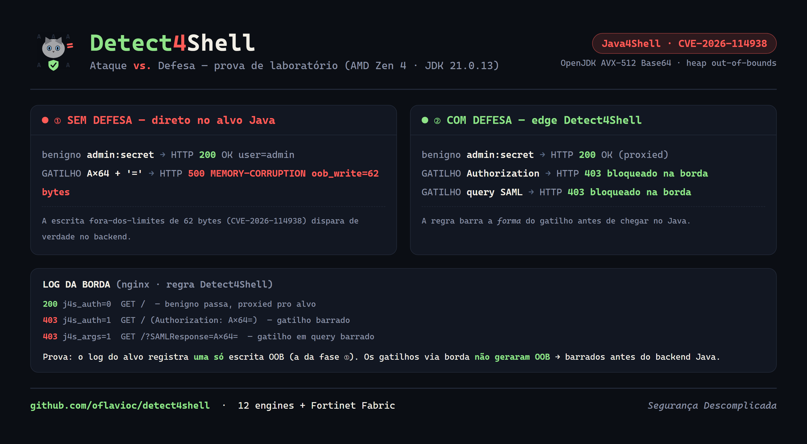

# Demo — ataque vs. defesa do Java4Shell (CVE-2026-114938)

Mostra, passo a passo, o **ataque acontecendo** (a escrita fora-dos-limites de 62 bytes do
Java4Shell) e depois a **defesa na borda** barrando o mesmo request **antes** de chegar no Java —
usando a regra nginx **do próprio repo** ([`../regras/nginx/detect4shell.conf`](../regras/nginx/detect4shell.conf)).

**Quatro caminhos para a mesma história (ataque → defesa).** Este README percorre o **demo nginx** — o
caminho atual, 100% por terminal, logo abaixo. Há mais três, que mostram o mesmo gatilho com a stack
Fortinet real e de forma visual:
- **FortiWeb ao vivo** — assinatura custom num FortiWeb-VM barrando o gatilho na borda, passo a passo
  pela GUI do appliance (criar a assinatura, isolar o policy de teste sem tocar no público, provar o
  `403`): [`fortiweb/README.md`](fortiweb/README.md).
- **FortiGate IPS ao vivo** — custom signature num FortiGate-60E 7.4.12 **detectando** o gatilho
  inline na camada de rede (IPS), passo a passo pela GUI (criar as 3 sigs, sensor em Monitor, policy
  de teste isolada, provar a detecção): [`fortigate/README.md`](fortigate/README.md).
- **Console de Ataque (visual)** — app web Java que dispara o gatilho e **classifica o resultado em 4
  estados**: ✅ chegou e disparou o OOB · 🛡️ barrado pelo WAF · ⚠️ chegou mas **não** disparou (JVM
  mitigada / CPU sem VBMI / patch) · ❓ sem resposta. Mostra a diferença entre "passou na borda" e
  "backend de fato explorável" sem ler log: [`console/`](console/).

> ⚠️ **SÓ LABORATÓRIO.** O alvo é um servidor Java **deliberadamente vulnerável**. O caminho
> principal deste demo (**passos 1–3, que todo mundo roda**) sobe o alvo em **loopback**
> (`127.0.0.1` — o default do servidor), **não** alcançável pela LAN. Só a **FASE 2** (passo 4 — o
> container nginx precisa alcançar o alvo via `host.docker.internal`) exige um bind de rede
> (`0.0.0.0`); lá isso é uma **exceção deliberada e marcada**, **só em rede isolada/confiável** e
> **nunca** exposta na Internet. O próprio alvo imprime um **AVISO no stderr** sempre que bina em
> algo diferente de loopback. Não é um exploit: o "payload" é a string Base64 malformada já pública
> (`A×64 + "="`), e toda consequência fica dentro do processo (ele **mede** a violação de memória;
> não é weaponizado).

> 🧪 **Trava de loopback no `atacar.sh` (higiene de lab).** Por padrão, o `./atacar.sh` só dispara
> contra **loopback** (`127.0.0.1`/`127.0.0.0/8`, `localhost`, `::1`, `*.localhost`) — os passos
> abaixo usam `127.0.0.1`, então **nada muda**. Para um alvo em outro host (só em rede isolada e
> autorizado), habilite **explicitamente** com o env: `D4S_ALLOW_REMOTE=1 ./atacar.sh http://HOST:porta/`.
> Sem o opt-in, um host não-loopback é recusado (saída `2`) com uma mensagem clara. A mesma trava
> existe no Console de Ataque ([`console/`](console/)) via `--allow-remote` ou `D4S_ALLOW_REMOTE=1`.



## O que você vai ver (resultado real, capturado)

```
FASE 1 — SEM DEFESA (direto no alvo :18080)
  benigno                 -> HTTP 200 | OK user=admin
  GATILHO (Authorization) -> HTTP 500 | MEMORY-CORRUPTION cve-2026-114938 oob_write=62 bytes
  GATILHO (query SAML)    -> HTTP 200 | OK user=anon   (este alvo só modela o sink Authorization;
                                                        a query só é barrada pela borda nginx na FASE 2)

FASE 2 — COM DEFESA (edge nginx Detect4Shell :8088)
  benigno                 -> HTTP 200 | OK user=admin
  GATILHO (Authorization) -> HTTP 403 | Detect4Shell: ... bloqueado na borda
  GATILHO (query SAML)    -> HTTP 403 | Detect4Shell: ... bloqueado na borda

LOG DA BORDA (nginx):
  200 j4s_auth=0  GET /                       <- benigno passa, proxied pro alvo
  403 j4s_auth=1  GET /  (Authorization)      <- gatilho barrado na borda
  403 j4s_args=1  GET /?SAMLResponse=...=      <- gatilho em query barrado

LOG DO ALVO: só 1 escrita OOB (a da Fase 1). O gatilho da Fase 2 NÃO gerou OOB
             => a borda barrou antes do backend Java.
```

## Três fatos honestos sobre o demo
- **A escrita OOB de 62 bytes é HEAP-DEPENDENTE, não determinística:** mesmo input, o reprodutor
  oficial estoura 100% (padrão de alocação fixo) mas um loop com arrays frescos ~0% — ela só dispara
  quando há bytes Base64 válidos logo **após** o buffer de decode. O **crash (DoS)** é, portanto,
  **probabilístico** (a escrita cai em *slack* de TLAB) e uma exploração confiável exige *heap grooming*.
  Este demo usa o padrão do reprodutor, então o `oob_write=62` dispara de forma estável — mas é sinal
  **de lab**, não garantia nem IoC de produção.
- **Precondição de hardware:** o OOB só dispara em CPU **x86-64 com AVX-512 VBMI** (Intel Ice Lake+ /
  AMD Zen 4+) rodando **OpenJDK 17.0.6+ / 21 / 25 / 27** não corrigido. ARM e CPUs sem VBMI são imunes.
- **Sinal sintético, NÃO um IoC:** `oob_write=62` e o `HTTP 500` são instrumentação **deste alvo de
  lab** para provar o primitivo — não são indicadores de produção. Um WAF/filtro que bloqueia não prova
  que o host era explorável; um que não bloqueia não prova que era seguro. Banner, match de regra e o bug
  do intrínseco são **três coisas diferentes**.

## Pré-requisitos
- JDK **21/25/27 não corrigido** (`javac`/`java` no PATH). ⚠️ Este demo usa o gatilho de **64 chars**
  (`A×64+"="`), que dispara em 21/25/27. **Em JDK 17 o gatilho é `A×128+"="`** — contra um alvo rodando
  JDK 17, o payload de 64 chars faz o alvo responder `400 "SEM escrita OOB"` num JVM **genuinamente
  vulnerável** (falso-negativo); troque o payload para 128 chars.
- CPU com **AVX-512 VBMI** (ver "Dois fatos honestos"). Checagem: `laboratorio/verificar_patch.sh` roda
  só em **Linux/WSL** (lê `/proc/cpuinfo`); no Git-Bash do Windows ele imprime "PULADO". No Windows,
  rode-o via WSL ou dentro do Docker lab (`laboratorio/Dockerfile`).
- **Docker** (para o edge nginx). O container alcança o alvo via `host.docker.internal`.

## Passo a passo

### 1) Compilar e subir o alvo vulnerável
```bash
cd demo/alvo
javac VulnBasicAuthServer.java
java VulnBasicAuthServer            # default seguro: bina em 127.0.0.1:18080 (loopback)
```
Espere a linha `[alvo] vulneravel ouvindo em 127.0.0.1:18080`. Em **loopback** (o default, sem passar
`0.0.0.0`) o alvo **não** é alcançável pela LAN — é o caminho que todo mundo roda para a FASE 1 e a
mitigação (passos 2 e 3). Esse processo **bloqueia o terminal** — **abra um segundo terminal** para
rodar os ataques (os `./atacar.sh` saem sempre de `demo/`; os `java VulnBasicAuthServer` saem de
`demo/alvo/`, onde está o `.class`).

### 2) FASE 1 — ataque SEM defesa (direto no alvo)
```bash
cd demo
./atacar.sh http://127.0.0.1:18080/
```
O gatilho retorna **HTTP 500 `oob_write=62 bytes`** e o alvo loga `!!! ESCRITA OOB DE 62 BYTES`.
**→ print:** terminal do ataque + terminal do alvo lado a lado.

### 3) (Opcional) mitigação por flag de JVM — zero código
Derrube o alvo (Ctrl-C no terminal do servidor) e suba com o intrínseco vulnerável desligado (segue no
default **loopback**):
```bash
# terminal do servidor (em demo/alvo)
java -XX:-UseBASE64Intrinsics VulnBasicAuthServer
```
```bash
# terminal do ataque (em demo)
./atacar.sh http://127.0.0.1:18080/
```
Agora o gatilho vira **HTTP 400 `SEM escrita OOB`** — a flag `-XX:-UseBASE64Intrinsics`
(product/default no HotSpot) força o Base64 puro-Java, imune. **→ print.**

### 4) FASE 2 — defesa na borda (edge nginx Detect4Shell)
Esta fase sobe o **nginx Detect4Shell** na frente do alvo. O **container** alcança o alvo via
`host.docker.internal`, que — no Docker Desktop / rede bridge — resolve para o **gateway do host**,
**não** para o loopback do host. Por isso, **só nesta fase**, o alvo precisa escutar num endereço de
rede em vez de loopback.

> 🚨 **EXCEÇÃO deliberada — só a FASE 2, só em rede isolada.** Derrube o alvo (Ctrl-C) e **re-suba em
> `0.0.0.0`** apenas para o container alcançá-lo. Isso o deixa **alcançável pela LAN** — rode **só** em
> **rede isolada/confiável** e **nunca** o exponha na Internet. Na subida o alvo imprime, de propósito,
> um **AVISO no stderr** (`[alvo] AVISO: bind 0.0.0.0 alcancavel na rede ...`) para lembrar que você
> saiu do default loopback.
```bash
# terminal do servidor (em demo/alvo) — SÓ nesta fase, SÓ em rede isolada:
java VulnBasicAuthServer 0.0.0.0 18080
```

Com o alvo no ar em `0.0.0.0` (a exceção acima), suba o nginx com a regra do repo:
```bash
docker run -d --name d4s-edge \
  --add-host host.docker.internal:host-gateway \
  -p 8088:80 \
  -v "$(pwd)/edge-nginx/nginx.conf:/etc/nginx/nginx.conf:ro" \
  nginx:1.27-alpine
```
> No Git-Bash (Windows) use o caminho absoluto `C:/...` e prefixe `MSYS_NO_PATHCONV=1`.

> 💡 **Alternativa sem `0.0.0.0` (Linux).** Em Linux dá para manter o alvo em **loopback** e dar ao
> container acesso ao loopback do host com `docker run --network host` — aí o nginx fala com
> `127.0.0.1:18080` direto. **Trade-off:** `--network host` só vale no **Linux** (no Docker Desktop de
> macOS/Windows o daemon roda numa VM e **não** compartilha o loopback do host) e exige apontar o
> `proxy_pass` do [`edge-nginx/nginx.conf`](edge-nginx/nginx.conf) para `127.0.0.1:18080` em vez de
> `host.docker.internal:18080`. Fora do Linux, use a exceção `0.0.0.0` acima — em rede isolada.

Ataque agora pela borda:
```bash
./atacar.sh http://127.0.0.1:8088/
```
Benigno → **200** (proxied); gatilho (Authorization e query) → **403** bloqueado. **→ print.**

Logs da borda (a evidência do bloqueio + qual regra casou):
```bash
docker exec d4s-edge cat /var/log/nginx/j4s.log
```
Prove que o gatilho barrado **não chegou** no backend (o log do alvo não ganha novo OOB). **→ print.**

### 5) Limpeza
```bash
docker rm -f d4s-edge
# e encerre o processo java do alvo
```

## Como isso vira a stack real (FortiWeb / Fortinet)
A mesma lógica roda nos engines da pasta [`../regras/`](../regras/). Para a defesa de borda com a
stack Fortinet, a assinatura custom do FortiWeb está em
[`../regras/fortiweb/detect4shell.md`](../regras/fortiweb/detect4shell.md) (modo reverse-proxy,
ação `alert_deny`) e a correlação em FortiSIEM/FortiAnalyzer em
[`../regras/siem/fortisiem-fortianalyzer.md`](../regras/siem/fortisiem-fortianalyzer.md).
**Importante:** o gatilho não tem metacaractere de ataque (é só Base64 + `=`), então o conjunto de
assinaturas **padrão** de um WAF não o pega — é preciso a **assinatura da forma** (a do Detect4Shell).

**Quer ver no appliance de verdade?** O passo a passo **ao vivo** num FortiWeb-VM está em
[`fortiweb/README.md`](fortiweb/README.md): criar a Custom Signature com a regex canônica, isolar a
Signature Policy só no virtual server de teste (sem encostar no policy público) e provar o `403` de
bloqueio com Attack ID. **Sem overclaim:** lá o **OOB** (estado verde) é demonstrado contra o **alvo
Java local vulnerável**, e o **`403` (Deny)** contra o **FortiWeb** — dois fatos separados, cada um
provado onde de fato aconteceu. E bloquear na borda é controle **compensatório**: o conserto é
**corrigir o JDK** (builds `.1`).
